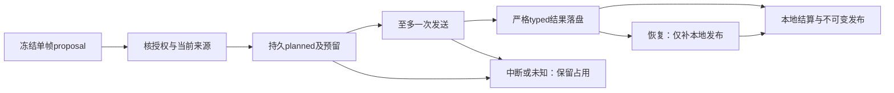

# 单注册帧自动静态观察

2026-10-24，Phase 0／F010。[当前sprint](../exec-plans/sprint-static-observation-generation.md)记录实施与验收状态；下列R1–R9合同约束已通过159项行为检查、静态／包与唯一独立评估；真实视觉准确率仍未验证。原[独立静态声明](static-observation-index-spec.md)的类型、发布与查询合同保持。

## 使用目标

从一个明确Completed版本选一张已登记画面，程序固定图片与来源，模型只返回该帧中的主体及五种静态属性。生成结果独立保存并可按同人物／同部件条件查询；没有动作事件的画面也能处理。结果是待核实声明，程序不会把它变成人类判断或动作理解结论。

## 身份和分层

- Application新增单帧proposal、独立Provider port、授权与一次执行协调；Infrastructure实现HTTP静态Provider和新attempt／账本持久化；CLI只装配流程。Domain沿用静态typed模型，保持不含I/O。
- prepare仅本地读取；冻结规范数据库／固定项目账本位置、Completed run、collection/profile、media/source/config/pipeline、单evidence图字节hash与源时钟，以及provider/model/prompt/schema/vocabulary/参数/价格身份。
- execute及恢复重新核对冻结身份。路径、时间、来源和绑定由程序注入，模型不能指定run/event/evidence或替换图片。
- 复用现有静态artifact构造和不可变SQLite发布／精确collection读取；不伪造SemanticEvent或CandidateDetail，不修改原timeline。

## 模型输出与数据保存

输出协议为parts-v2：actors内必须显式声明局部parts，以partGroup＋partIndex保留每件衣物／持有物关系，不能由程序将平面actor属性归成一个物品。每个part仅含hair_color、clothing_color、clothing_shape、held_shape、held_class中该组允许的冻结属性；重复part、跨组属性及旧平面协议拒绝。重复键、额外字段、动作／环境／异帧内容、错误类型及超限响应拒绝。合法空actors记no_observations，仍封装一条引用真实注册帧的observation，不伪造主体。

原视觉响应仅在内存中有界解析，禁止保存任意HTTP正文、原响应JSON、异常正文或密钥。仅保存严格typed结果、真实InvocationMetadata／ProviderUsage、响应SHA与字节数及白名单诊断。成功解析不代表模型看对画面。

## 新授权池与一次发送

静态生成有独立具体授权：冻结proposalHash、项目与数据库／账本身份、provider和参数、有限正金额、请求数1、图片数1及人类授权引用，并须显式允许调用。prepare不会创建人类许可。用户提供素材、旧API余额或开发模型许可不授权真实发图。

固定项目账本不随collection、输出目录、授权副本或重启清零；相同authorizationId换内容拒绝。请求锁跨一次执行，预算锁仅包预留／结算而不跨HTTP。发送前持久planned及可重建预留；崩溃后无法证明未发送时不重试。known费用按同attempt一次结算；usage缺失保留unknown预留，actual超额照实记录。

图不承诺跨文件原子事务：实现须明确账本与attempt的写入顺序，任一中间态保守重建，不把unknown当零，不删除账本逃过失败。损坏账本或不明状态失败关闭；成功和未知请求再次执行均不发图。已落盘typed结果可恢复发布，落盘前崩溃保留planned未知。

## 验收与范围

用合成注册图、真实SQLite和生产装配，仅替换网络transport。验证成功后另进程typed查询；并发、未知费用、各持久化断点、授权副本／输出迁移、来源／版本漂移、坏响应和损坏账本都必须有行为证据。静态检查及离线包在审阅后集中执行，未变结果不重复全套。现有数据／费用／标注／V6保护哈希保持。

本轮工程开发不发送真实游戏图片，F006/F009/F010继续false。真实Provider接受性和视觉准确性需具体新费用提案与后续独立人工核验，不要求重新做已有标注。
