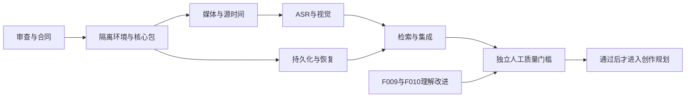

# Phase 0依赖、里程碑与下一交付

2026-10-24最新：[自动静态生成离线交付](report-2026-10-24-static-observation-generation.md)，正式159passed／1skip、静态／包及唯一评估PASS。单帧真实提案已冻结、尚未授权，旧录像／费用／标注保持；真实质量仍是下一门槛，不转入后续创作阶段。

更新：2026-10-24。当前事实见[里程碑总览](current-status.md)，验收真值见[feature_list](../../feature_list.json)。本次清理不修改[总方案](../../游戏内容创作与商业化产品总方案%20V1.0.txt)范围或[评测门槛](../references/phase-0-benchmark.md)；以前密集的离线扩展、暂停／授权节点及完整旧定义保存在[历史计划](phase-0-plan-history-2026-10-22.md)。

## 已交付和未通过的门槛

| 特性 | 状态 | 内容与依赖 |
| --- | --- | --- |
| F000 | 技术合同通过 | 反向审查、范围与证据纪律 |
| F001 | 技术合同通过 | 固定项目隔离工具链、四层包与CLI；前置F000 |
| F002 | 技术合同通过 | 本地媒体、源时钟与证据；前置F001 |
| F003 | 技术合同通过 | ASR／视觉Provider、版本／用量／费用；前置F002 |
| F004 | 技术合同通过 | SQLite、账本、检查点与恢复；前置F001 |
| F005 | 技术合同通过 | 已保存时间线检索、排序／证据与联合搜索；前置F003/F004 |
| F007/F008 | 技术验收通过 | 获准的本地检查工作台、布局与时间顺序选片篮，非正式桌面产品 |
| F009/F010 | 已实现／实验，未通过真实质量验收 | 连续动作、人物／部件／帧支持，不能以保存成功替代准确性 |
| F006 | 工具齐备，独立人工质量未通过 | 人工参考、冻结来源、明确Completed绑定与固定十位计分 |

最近工程交付：长录像P1与原run接续已结束，3拒绝缺口保留；已有细节联合排名兼容／来源绑定已完成caa29d0。98项回归和静态检查只证明本轮工程行为，不解除F006/F009/F010。

2026-10-23配套交付已完成：[TD014验收工作流状态竞态](report-2026-10-23-acceptance-state.md)使已完成步骤可靠显示完成、真实中断继续保留，29项／静态检查／独立评估通过。TD006本轮资格对齐及三类合成时钟Chromium验证亦已完成，64项／静态检查／唯一评估通过；特殊时钟自动映射保留open。TD009独立静态声明导入和搜索亦已完成，202通过／1权限skip及唯一评估PASS，见report-2026-10-24-static-observation-index.md。单帧自动生成离线闭环现已交付，下一按具体新授权做真实单帧协议验证；不新增录像调用或人工要求。用户新三游戏6素材已登记可用，独立性和正式参考尚待相应触发确认。

## 当前主要交付：真实检索质量证据

1. 确认已有素材原录制分组和开发／独立测试用途。复用已保存原片答案，补新增来源和真正缺少的事件类型；当前10个已标样例分布1/5/4，不能凑主查询至少10个参考事件。
2. 按最终10–20段代表素材目标分批准备。在分析或查看模型结果前登记查询、真实事件区间、reviewer和labelVersion，确认来源分组后冻结评测计划；未知不改为负例，不从文件名或模型摘要生成标签。
3. 若需要新增模型分析，冻结具体来源、图片、参数、所有尝试与最高新增费用提案，获得明确新授权才执行。已有pending参数、预算余额或旧请求许可都不等于新授权。
4. 只有合格Completed版本能绑定；长钟馗269成功／3拒绝当前不可绑定。三缺口保留／另立补窗／暂缓按原human-inputs状态，不擅自处理。
5. 生成固定排名后及时提供真人评审入口。逐主查询至少7个不同事件获2/3分；缺位／重复计零，不从第11条补位。少例／负例独立报告，时间、成本、独立性等未知保持null。
6. 用具体漏检／误检推动F009/F010改进；若对测试集调参，换独立最终验证集。人工依赖仅阻断相应步骤，独立离线工作继续；不连续补词表／信封校验替代阶段交付。

## 架构和后续阶段

继续遵循[四层架构](../design-docs/architecture.md)、[工程合同](../design-docs/phase-0-engineering-spec.md)、ADR-001 Python及ADR-002本地检查工具。Domain无I/O；Provider／配置／提示词／源时钟／旧标注与未知费用保持。架构本轮未改变，无新ADR。

总方案§58–64后续依次是Creative Planner → Edit Decision＋FFmpeg成片 → 正式Windows EXE → 活动规则／多平台／发布包 → 真实账号发布。当前均未进入交付，先通过原Phase 0可用性门槛，不将JSON/CSV区间导出称为MP4成片。

任务分配和实现按[分工](assignments.md)及[开发三角色流程](../references/development-agent-pipeline.md)；小型文档事实修正由主控完成，不重跑与改动无关的整仓测试。每次主要交付同步本计划／HANDOFF／progress／human-inputs的当前事实，历史证据留档。
