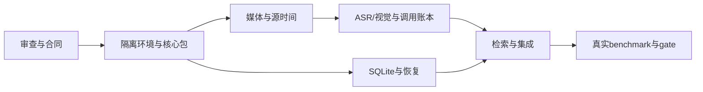

# Phase 0 开发任务与依赖

> **2026-10-22 离线补强：** TD009 matcher 同居 UNCERTAIN 阻断 OBSERVED FULL（v1.1，已推送 `8aac1d2`）；不清除三缺口；不代选 A／B／D；不标 F006 true。

> **2026-10-22 离线补强：** JUMP 标题品牌 hybrid／semantic 排除（TD004，已推送 `fb984ea`）；不清除三缺口；不代选 A／B／D；不标 F006 true。

> **2026-10-22 离线补强：** 检索忽略 JUMP 标题品牌噪声（TD004，已推送 `0497ebf`）；不清除三缺口；不代选 A／B／D；不标 F006 true。

> **2026-10-22 离线补强：** TD010 本机 Completed 只读对照（pytest + artifacts sqlite，已推送 58b3f73）；不清除三缺口；不代选 A／B／D；不标 F006 true。

> **2026-10-22 离线补强：** TD010 混合语义边界／离线 DB 形对照（已推送 51b0f56）（positive_text 禁回退＋golden JSON）；不清除三缺口；不代选 A／B／D；不标 F006 true。

> **2026-10-22 离线补充：** 检索否定护栏忽略裸 mechanicTags（TD010，已推送 `1d0f70d`）；不清除覆盖缺口；不代选 A／B／D；不标 F006 true。

> **2026-10-22 离线补充：** 素材任务行嵌入 coverageGapSummary 拒窗摘要；不清除覆盖缺口；不代选 A／B／D；不标 F006 true。

> **2026-10-22 离线补充：** 工作台／API 只读 coverage-gap-report；不清除覆盖缺口；不代选 A／B／D；不标 F006 true。

> **2026-10-22 离线补充：** coverage-gap-report 只读产品能力（缺口 run／拒窗汇总）；不清除覆盖缺口；不代选 A／B／D；不标 F006 true。

> **2026-10-22 离线补充：** acceptance-readiness inertContract 跨面落地（health／JS）＋feature_list 闸门测试；不清除覆盖缺口；不代选 A／B／D；不标 F006 true。

> **2026-10-22 离线补充：** acceptance-readiness 嵌入 inertContract 机读护栏；不清除覆盖缺口；不代选 A／B／D；不标 F006 true。

> **2026-10-22 离线补充：** 跨面 acceptance-readiness 惰性合同（CLI／工作台／验收流程）；不清除覆盖缺口；不代选 A／B／D；不标 F006 true。

> **2026-10-22 离线补充：** 验收流程关联步骤挂接只读 readiness；不清除覆盖缺口；不代选 A／B／D；不标 F006 true。

> **2026-10-22 离线补充：** 共享 WaitingTransport／IdleRecorder 测试双件；不清除覆盖缺口；不代选 A／B／D；不标 F006 true。

> **2026-10-22 离线补充：** 工作台「验收就绪」只读展示与 CLI 同源；不清除覆盖缺口；不代选 A／B／D；不标 F006 true。

> **2026-10-22 离线补充：** `acceptance-readiness` 只读汇总资格／阻断；不清除覆盖缺口；不代选 A／B／D；不标 F006 true。

**2026-10-22 主线快照（覆盖缺口脚手架后）：** P1 隔离与长钟馗接续已完成；覆盖缺口离线护栏／草稿／写出／诊断链接已齐；任务列表现区分 `analysis.coverage_gap` 与检索资格；NL 检索入口亦以 `retrieval.coverage_gap` 明确拒绝缺口 run；工作台 inspect／搜索 UI 已对齐同一拒文与 `searchEligible`；视觉传输层非200错误正文已有界保留便于离线诊断；inspect／工作台已展示失败调用的 schema／http 诊断投影；离线测试假传输已合并为共享 FakeVisionTransport／WaitingTransport／IdleRecorder；正式评测／绑定／细节核对入口亦接入同一检索资格闸；验收流程关联分析时 coverage_gap 任务不可选并显示同一拒文；CLI／工作台／验收流程三面只读 `acceptance-readiness` 已挂接且跨面惰性合同加固（永不宣称通过）。正式 F006 仍待人评与（若要坚持本片）选项 B 新授权，或选 A 改用其他 Completed 素材。F006/F009/F010 仍 false。以下历史交接节点保留。

**2026-10-11交接决策**：TD007/P1局部结构错误中断整片为当前阻断；新对话直接修复失败处理，再继续同一长钟馗，多帧保护保留。[接手清单](resume-long-zhongkui-20261011.md)记录原因／权限／步骤，不要求重标、重抽或重复批准本地开发。当前仅交接未修复，Phase 0与F006/F009/F010false保持。

**2026-10-11最新主线节点**：v2长钟馗获得具体授权并执行一次，22次请求／198帧次／估算¥0.10848724，0新unknown；21／272窗口、19观察保存，单事件起止同帧触发provider.schema，76.05772秒exit4，完整分析未完成。独立执行费用／身份边界PASS不等于模型质量通过；未绑定／检索／人评，另两任务未执行。正式gate与F006/F009/F010保持未通过。

**下一依赖及交付**：按TD007和[sprint-long-analysis-reliability](sprint-long-analysis-reliability.md)planned合同草案，先定义拒绝窗口的覆盖／任务资格与版本化失败处理再离线实现。多帧动作保护继续；不能拿单帧、删字段或未完成任务换Completed。本轮原许可不覆盖手工重跑，新的付费策略待具体提案再授权；当前无需补标，Completed并固定结果产生才提醒候选评分。不会越阶段进入正式桌面／剪辑／商业功能。

## 分析启动前节点（历史；新费用和发送授权已收到）

**2026-10-11当前节点：真人参考进入有限对照。** 已收到12事件，按用户确认排除两长剑特写并纠正老者理由，保留原文件、完整12查询与原参考包。已导入并冻结长钟馗的boss1／连招5／剧情4共10个已标样例；唯一关键边界审查及v2最终读回通过，0新分析／预留。见[sprint](sprint-human-reference-pilot.md)和[汇报](report-2026-10-11-human-reference-pilot.md)。

**下一依赖**：新增最高¥5的长钟馗全片分析尝试已具具体v2提案（SHA f608c4dedac6），1903注册图片、272正常窗口／2445帧次，含重试最多500实际尝试／5000帧次、每窗口3次。先取得新费用与图片发送授权，再执行已保存run；预算不足保留进度且不加预算，不保证Completed，只有Completed才能绑定并输出固定人评候选。旧unknown不变，旧v5授权不可复用。当前三样例查询无需补标；其余未知项及更多独立素材保留正式验收待办。

**验收口径**：当前sparse仅表示已标样例有限，不证明全片只有1／5／4个事件；全片总量／穷尽覆盖／全片Recall未验证。空参考和“似乎没有”不能当确认负例。单来源三查询不足正式代表集和主查询，readiness=false、qualityGate=null，F006/F009/F010false；总方案与阶段范围保持，不能凭小对照进入正式桌面／剪辑／商业阶段。

## 三段原片准备节点（历史；首份参考现已收到）

**2026-10-11当前节点：独立质量验收的三段原片准备已交付。** 用户给《钟馗》两段与《42中队》一段，确认未看对应AI结果，事前指定boss战／武器展示界面／释放连招／剧情演示四类需求。12组合已登记，三素材仅本地准备为pending，原片页补录像名；48.449秒／3145图／三音轨，完整媒体独立读回与两尺寸播放、22相关项通过，0模型／新预留。见[sprint](sprint-independent-footage-preparation.md)及[通俗报告](report-2026-10-11-independent-footage-preparation.md)。

**人工／下一执行依赖**：references-v2原片页已交付并提醒保存；原片正确区间仍待真人。两钟馗暂保守同组，真实来源关系未确认；12项暂main，须依原片内容确认少例／负例或补充素材后才正式冻结，三原片／两个保守组不等于10–20段完整代表集。后续为核对参考及分组→冻结→具体新费用／发送授权→分析→明确Completed绑定→固定十位真人评分。当前F006/F009/F010false，仍Phase 0；断网只影响授权分支补推，不影响已准备原片页。

## 上一费用交付节点（历史）

**本轮发布回执**：真实费用登记和读回已在本机完成，完成记录已保存03e1534。一次普通push在21.115秒连接GitHub:443失败／exit1，未重复推送或读取远端；最后确认远端f5a3a69，网络恢复后补推当前授权分支。当前功能代码此前已发布，失败不影响本机费用显示；不得重跑真实导入。最终本地HEAD及回执见Git／.cache/detail-billing-publication.json。

**2026-10-11当前里程碑**：Phase 0费用确认已交付。唯一独立guard最终PASS后，按原用户答复为两个旧HTTP400各追加一次不可变确认；工作台显示释放报告预留¥4.065536、核对后精分析占用¥0.04673416。原API未知2次／保守占用¥4.11227016／账本／发送上限和更早基础unknown保持。921旧项目文件及40保护不变，只新增两确认；新进程／wheel／1366和390实际页面读回通过，0额外模型、搜索和真人识别标签。一次完整2477passed／五旧TD014非通过／两权限skip，新57passed／1skip，不重跑。源码ff95517已发布授权codex/visual-details，本次完成记录同步同一分支，最终回执以Git及.cache/detail-billing-publication.json为准。

**开发中／人工待办／下一步**：v5指定两请求已执行、授权耗尽，一schema失败／一近景发布，用户稍后核对，判断仍null。按Planner返回原F006独立质量验收：真人确认来源分组和分析前原片参考后，冻结→Completed绑定→固定前十评分；现有工具链齐全，不能代填参考或越过gate。F006/F009/F010false。主控负责记录与后续执行，Generator／Planner／guard均完成，无并行写者；下方暂停、无真实v5、待评估和0导入均为历史。

依据 [反向审查](./reverse-review-2026-10-03.md)、[工程合同](../design-docs/phase-0-engineering-spec.md) 和原方案 §71。保持 F001–F006 ID，避免交接时重复创建特性。F001–F005 的技术合同已验收，CLI Demo实测见 [sprint-demo](./sprint-demo.md)。F006工具已实现，独立人工质量gate仍未通过；旧spike仅为F000证据。

## 独立质量验收合同（持续适用）

沿用已有F006合同与工作台，不新建相同入口。先由真人确认代表性录像／原录制分组与开发、独立测试用途，再在独立素材分析或查看结果前登记查询、原片正确事件和区间；主查询至少十个独立可用参考事件。未知字段留空，不能从文件名或模型摘要生成真实标签。

材料齐备后root按现有流程冻结、绑定明确Completed版本并生成固定排名。若需新模型分析，先冻结具体素材／参数／费用提案，获得新授权再执行。排名产生时即时提醒真人评分，十个固定位置缺位／重复计零，逐主查询至少七个独立事件获2／3分才满足70%门槛；时间、独立性、费用等未验证项保持null。关键交付由既定Planner／Generator／Evaluator合同执行，不重复委派或反复催促。当前缺口是人类来源／参考证据，不将费用功能完成或开发样本结果视为F006通过。

## 历史里程碑及依赖定义

2026-10-11收尾时的当前里程碑（开发／验证节点2026-10-08）：[明确JSON的新v5](sprint-detail-temporal-json.md)已接精确只读／CLI／页面和冻结工具，原人物独立排名保持。17新增全部通过，一次完整2419passed／六旧非通过／1权限skip，旧TD012／TD014留证、不循环；双包99源码及现用两尺寸回看下载完成，911旧文件／39保护保持，0新调用／搜索／预留／人评。新v5无真实结果、细节1/227、严格复合仍partial，F006/F009/F010false。上一v4两请求HTTP400、用户核实零扣费，原API未知和保守ledger／更早另一unknown保持。新v5两候选六帧最高¥4.07提案已冻结未授权；恢复后处理具体新授权，再按真实结果提醒人工核对，正式F006来源／事前参考／固定评分另见[人工待办](human-inputs.md)。用户额度14%要求结束会话，收尾后暂停，不自动进入新阶段；[通俗报告](report-2026-10-08-detail-json.md)已保存，旧节点为历史。

2026-10-11用户追加的[模型分工配置](sprint-codex-agent-routing.md)属于工程协作方式，不新增产品阶段或改变质量gate；个人／项目六角色及默认Luna已安装，当前三模型实际执行通过。完成配置验证后继续原收尾暂停，录像项目不自动恢复。

| 特性 | 交付与文件归属 | 验证与依赖 |
| --- | --- | --- |
| F001 | `.tools` 隔离安装脚本/版本清单、pyproject.toml/uv.lock/.python-version、`src/gamingcreator` 四层包、DTO/Protocol、pytest/Ruff/mypy/导入检查 | 前提 F000。仅项目 uv/Python/venv 构建；无 Windows 注册/全局链接；输入错误码、类型与导入方向检查；锁版本，禁止系统 Python 兜底 |
| F002 | `infrastructure/media`、Evidence/时间映射、`tests/media` | 前提 F001。真实素材＋合成 VFR、非零 PTS、无音轨、坏文件、路径中文空格；取消退出与源时间可追溯，不能只测帧序号 |
| F003 | `infrastructure/providers`、`.venv` ASR/worker、prompts、`tests/providers` | 前提 F002。先 DeepSeek视觉＋一个本地ASR；静音/词表；JSON/schema/usage/预算/重试；第二Provider或合同替换验证，不伪造真实质量 |
| F004 | `infrastructure/storage`、SQL迁移、`tests/storage`；消费 F001 ports | 前提 F001；可与媒体/模型适配并行。run/checkpoint/证据/账本、FK/事务、文件丢失、进程中断与恢复，恢复保留未知费用 |
| F005 | `application/retrieval`、检索适配、`tests/retrieval`、CLI组合更新 | 前提 F003＋F004。固定run检索、词法与语义方案对照、去重/排序/证据/源时间；无片段合法、相同配置可复现 |
| F006 | benchmark执行器/人工标签清单、`tests/benchmark`、go/no-go报告 | 前提 F005；标签准备可先行。主组逐查询≥70%、少例/负例、独立测试集、时间误差、冷/热成本与长素材速度；不达标保留未通过 |

语言决策遵循 [ADR-001](../design-docs/adr-001-phase-0-language.md)：Phase 0 Python，未来正式桌面 UI 另作选型。2026-10-04 用户授权的 F007 本地检查工作台按 [ADR-002](../design-docs/adr-002-local-inspection-ui.md) 复用 Python 和零依赖静态页面，技术验收见 [sprint-inspection-workspace](./sprint-inspection-workspace.md)；它不改变 F006。F003 内部可将 ASR 与视觉拆为两项 owner，前提 DTO 已集成并分别拥有文件。公共 domain/ports 由 F001 owner 集中落地；其他 Agent 不同时改共享接口。pyproject/uv.lock 的跨特性依赖变更由集成负责人串行更新。每个编码会话使用独立 branch/worktree，在 `assignments.md` 分配后开始；根 HANDOFF/progress/feature_list 由集成负责人汇总。

人工标签准备：先在用户素材上形成开发事件表和查询，人工核对可见性；收集小时级录像与10–20代表会话后冻结主组。F000仅测三段；F002已完整处理额外275.831s Atom录像在内的四段，但不证明模型质量。同录制来源先放同组；模型标签不能代替独立人工标签。

执行先后：F001 确认项目环境与合同编译；媒体／存储并行；随后模型／存储集成；检索；最后真实 gate。每个任务用 `sprint-template.md` 记录 owner、分支、验证和转交动作。正式 UI、Creative Planner、Rendering 与商业系统在原定质量门槛通过之后另立阶段任务。

用户反馈后的当前纠正任务是F009连续动作与F010主体细节；已有V6分析Demo并不解除F006。接续按[sprint-actor-detail-matching](./sprint-actor-detail-matching.md)：先冻结主体/部件/证据合同和纯AND匹配，随后Application ports，再并行Provider/共享预算与sidecar持久化，最后由root接CLI/UI并做两候选有界试验。自由文本检索不自动得到严格复合保证，默认查询仍离线；具体归属、实现状态和检查点以HANDOFF及assignments为准。

2026-10-06用户要求主线交付优先，非阻断小bug归档后继续阶段任务，见agent-workflow。当前离线主线补齐F005／F006的长录像检索规模与全链路验证，见[sprint-long-footage-retrieval](./sprint-long-footage-retrieval.md)；F009/F010真实理解门槛及待授权调用保持未通过。按总方案推进，不用诊断微修替代阶段功能，也不越过原独立质量gate进入正式桌面／商业阶段。
